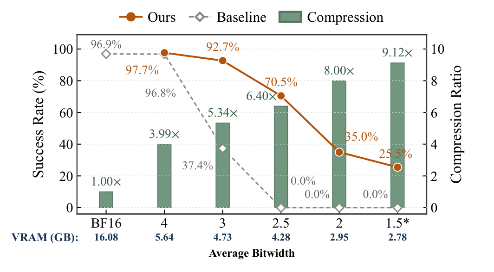
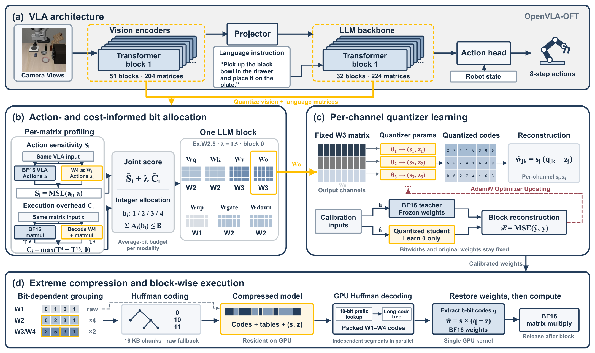
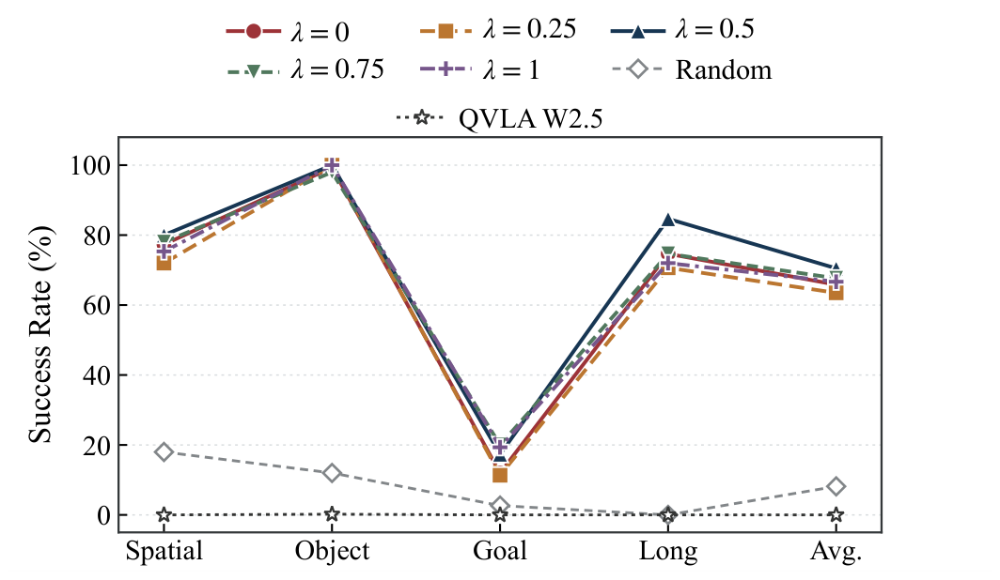
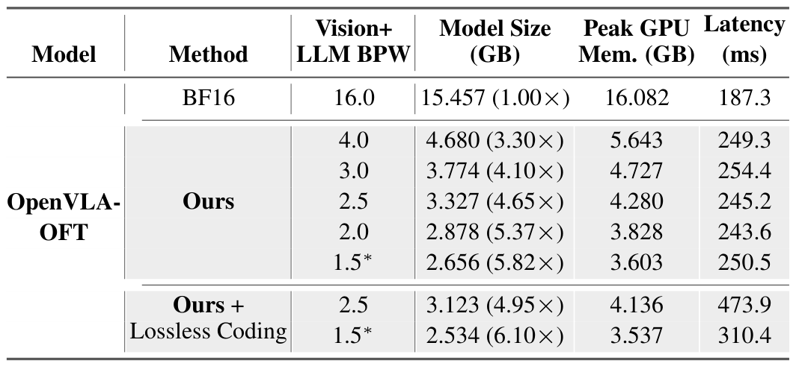

<div align="center">

# AGQ

### Action-Guided Ultra-Low-Bit Quantization<br>for Vision-Language-Action Models

**Preserve actions · Allocate precision · Recover weights on demand**

Xuhong Qiu · Zhuoyu Wu · Qiawei Zheng · Wenhui Ou · Wenqi Fang · Raphael C.W- Phan

[Paper](paper/AGQ_ISCAS_27.pdf) · [Paper figures](docs/PAPER_FIGURES.md) · [Principles](docs/PRINCIPLES.md) · [Get started](docs/GETTING_STARTED.md) · [13 cases](docs/CASES.md) · [中文](README.zh-CN.md)

</div>

AGQ assigns precision according to **action sensitivity and weight recovery cost**. It combines matrix-wise bit allocation, per-channel calibration, and grouped lossless coding to compress OpenVLA-OFT policies while preserving useful closed-loop behavior.

| W4 success | W3 success | W2.5 success | Complete-model compression |
| :---: | :---: | :---: | :---: |
| **97.7%** | **92.7%** | **70.5%** | **6.10×** |
| 586 / 600 episodes | 556 / 600 episodes | 423 / 600 episodes | Coded W1.5* storage |

<p align="center">
  <a href="assets/paper/figure1_compression_success.png"></a>
</p>

**Figure 1 · The compression–success tradeoff.** Original artwork from the paper; click any figure to enlarge. The bars measure **target-weight** compression. The 96.9% reference is **FP16 literature data**, despite the retained BF16 label. The low-bit memory minima and the main performance table use different decoders. [Figure notes and data](docs/PAPER_FIGURES.md#figure-1--compression-success-and-memory).

## News

- **2026-10-12 — Repository now public.** Code, documentation, and aggregate results are publicly accessible. Model weights and learned quantizer parameters remain excluded; the project license is pending.
- **2026-10-12 — Paper figures added.** All four figures and both complete result tables now appear on this page, with a [source and data index](docs/PAPER_FIGURES.md).
- **2026-10-12 — Code and examples.** Added W1–W4 calibration-to-execution components, official HQQ/Quanto matrix adapters, and **74 passing local tests**. [Start here](docs/GETTING_STARTED.md).
- **2026-10-12 — Thirteen cases.** Organized precision, allocation, task-family, failure, and resource analyses with machine-readable results. [Explore the cases](docs/CASES.md).
- **2026-10-09 — Evaluation completed.** Audited **6,000 closed-loop episodes** across ten configurations and four LIBERO suites; W2.5 at $\lambda=0.5$ achieved 423/600 successes.

[All project news](NEWS.md)

## The method

<p align="center">
  <a href="assets/paper/figure2_framework.png"></a>
</p>

**Figure 2 · From a full-precision policy to compressed execution.** The method targets **428 matrices**: 204 in vision and 224 in language. Each matrix keeps one integer bitwidth, preserving regular layouts.

| 1 · Measure and allocate | 2 · Calibrate | 3 · Encode and execute |
| --- | --- | --- |
| Probe action deviation and recovery overhead at W4. Assign W1–W4 under separate vision and language budgets. | Keep original weights and bitwidths fixed. Learn per-channel quantizers through block reconstruction. | Apply grouped lossless coding. Recover the active block's BF16 weights, compute, and release temporary weights. |

The W4 cost is an allocation proxy. Matrix multiplication uses recovered BF16 weights. [Equations, assumptions, and implementation](docs/PRINCIPLES.md).

## Closed-loop task success

<p align="center">
  <a href="assets/paper/table1_task_success.png"></a>
</p>

**Complete paper success table · Four suites, including the difficult cases.** AGQ reaches **92.7% at W3** and **70.5% at W2.5**. At W3, the reported advantage is 1.2 points over AWQ and 3.7 over GPTQ. At W2.5, Object retains 100.0% while Goal falls to 17.3%; the overall score does not hide that imbalance.

Each AGQ study configuration contains **600 episodes**: 150 per suite and 15 per task. The ten configurations total 6,000 episodes. AWQ, GPTQ, QVLA, and the 96.9% original-precision reference are literature reports. W1.5* uses W4 vision and average-W1.5 language, approximately **1.75 bits over target weights**. [Counts](results/quality.json) · [All 40 tasks](results/tasks.csv) · [Literature rows](results/published_baselines.json).

## Why allocate by actions and cost?

<p align="center">
  <a href="assets/paper/figure3_allocation_sensitivity.png"></a>
</p>

**Figure 3 · Matrix-level differences lead to different assignments.** The paper's combined table and three-dimensional views connect the measured priorities to the allocation. At W2.5 and $\lambda=0.5$, the **W1 / W2 / W3 / W4 matrix counts are 19 / 150 / 199 / 60**. These count matrices; they are not parameter-weighted average bitwidths. [Allocation data](results/allocations.json).

<p align="center">
  <a href="assets/paper/figure4_lambda_success.png"></a>
</p>

**Figure 4 · Test the allocation choice in closed loop.** At W2.5, guided configurations reach **63.5–70.5%**, versus **8.2%** for calibrated random allocation. The tested default $\lambda=0.5$ exceeds sensitivity-only allocation by **4.7 percentage points** in overall success. It does not win every suite. [Five-setting comparison and cases](docs/CASES.md).

## Storage and inference

<p align="center">
  <a href="assets/paper/table2_storage_performance.png"></a>
</p>

**Complete paper performance table · Storage savings and execution cost together.** Grouped-coded W1.5* occupies **2.534 GB**, giving **6.10× complete-model compression**. The same recorded configuration measures **3.537 GB peak allocated GPU memory** and **310.4 ms** per inference call on RTX3090; coding adds 59.9 ms over its uncoded counterpart.

Figure 1's **2.784 GB** minimum uses **CODEBOOK001**; the table's **3.537 GB / 310.4 ms** uses **CODEBOOK003**. EXP019 success scores and these coded performance records are separate measurements. [Precise definitions and trajectory-pairing results](docs/PAPER_FIGURES.md#measurement-notes) · [Performance data](results/performance.json).

## Explore 13 cases

| Read the behavior | What to inspect |
| --- | --- |
| **Quality across precision** | W3 retention, W2.5 Spatial/Object results, Goal failures, and W1.5* asymmetry |
| **Allocation choices** | Guided versus calibrated-random allocation, all five $\lambda$ settings, and 428 matrix assignments |
| **Deployment tradeoffs** | Whole-model storage, coding overhead, minimum-memory versus faster decoding |
| **Every task** | Suite-level outcomes and all 40 tasks, including failures |

[Open the illustrated case guide](docs/CASES.md) · [Browse the result files](results/) · [View the six paper figures and tables](docs/PAPER_FIGURES.md)

## Run the code

```bash
python -m pip install -c requirements/cpu-constraints.txt -e ".[test]"
python scripts/agq_quantize_demo.py --bits 1 2 3 4 --epochs 4
agq methods
agq compare --methods rtn --bits 4 --output outputs/compare_rtn_w4.json
python scripts/verify_results.py
```

The AGQ demo runs calibration, packing, lossless coding, and block-wise execution on generated tensors. Optional official **HQQ** adapters have been checked at **1/2/3/4/8 bits**; **Quanto** exposes verified **CPU int8**. These matrix examples report numerical errors. Full-policy inference uses the separate OpenVLA-OFT environment and user-supplied model assets.

**Validation:** **74 local tests passed without skips**: 52 AGQ component checks, 16 matrix-adapter checks, and 6 result-audit checks. This visual update adds no GPU or closed-loop experiments. Model weights and learned quantizer parameters are not distributed.

[Getting started](docs/GETTING_STARTED.md) · [Reproducing AGQ](docs/REPRODUCING_AGQ.md) · [Method integrations](docs/INTEGRATION_STATUS.md) · [Baseline adapters](docs/BASELINES.md) · [Validation record](docs/VALIDATION.md)

## Citation and acknowledgments

```bibtex
@unpublished{qiu2026agq,
  title  = {AGQ: Action-Guided Ultra-Low-Bit Quantization for Vision-Language-Action Models},
  author = {Qiu, Xuhong and Wu, Zhuoyu and Zheng, Qiawei and Ou, Wenhui and Fang, Wenqi and Phan, Raphael C.W-},
  year   = {2026},
  note   = {Unpublished manuscript}
}
```

AGQ builds on [OpenVLA-OFT](https://github.com/moojink/openvla-oft) and LIBERO. Its calibration follows OmniQuant's clipping and block reconstruction ideas. See [official references](docs/REFERENCES.md) and [third-party notices](THIRD_PARTY_NOTICES.md) for upstream work and attribution.

The repository is publicly accessible; the manuscript is recorded as unpublished, and the project license awaits an author decision.
