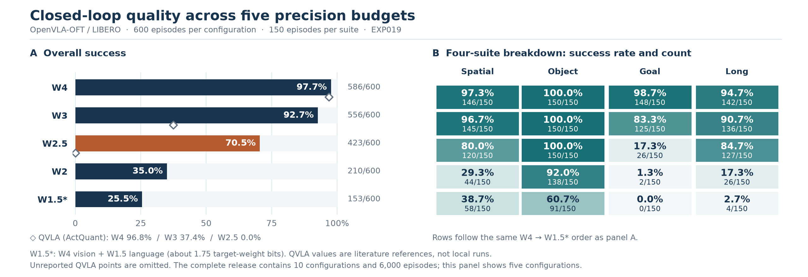
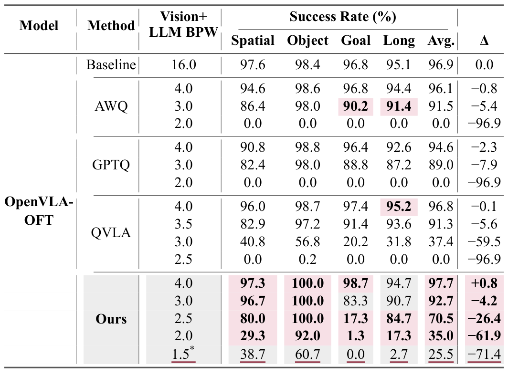
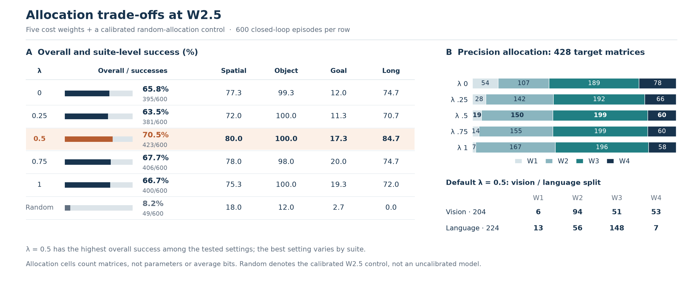
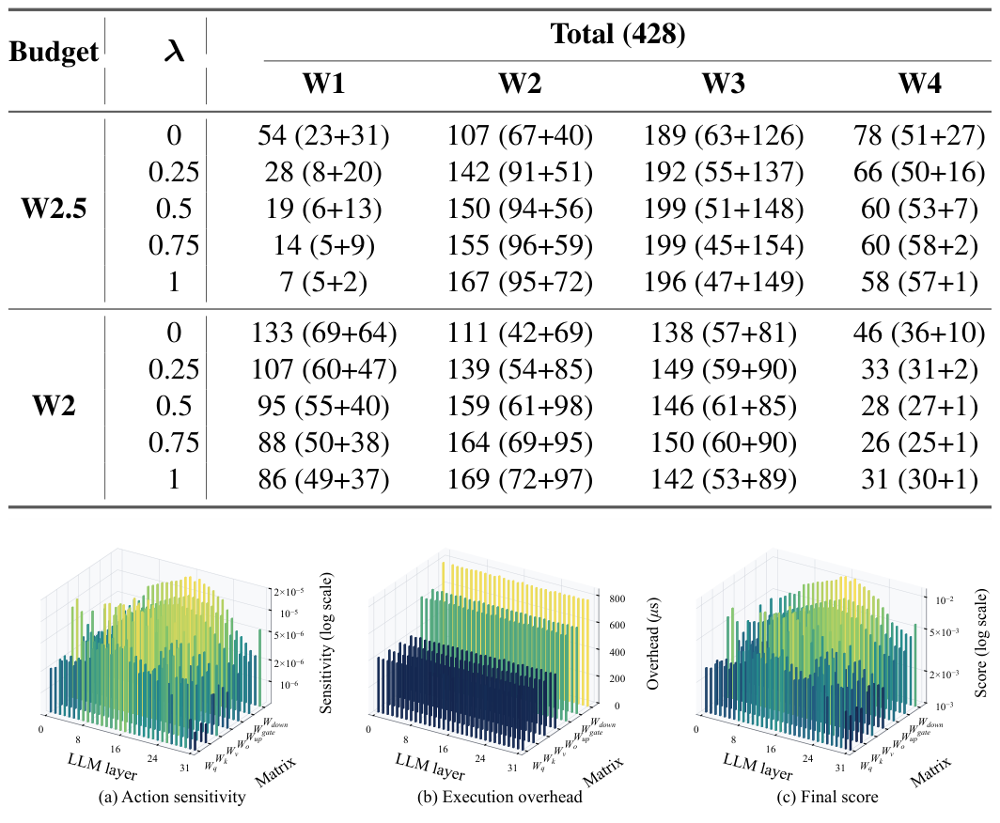
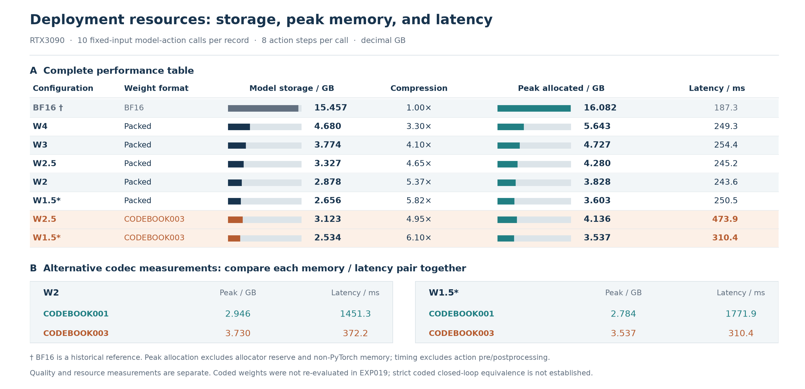
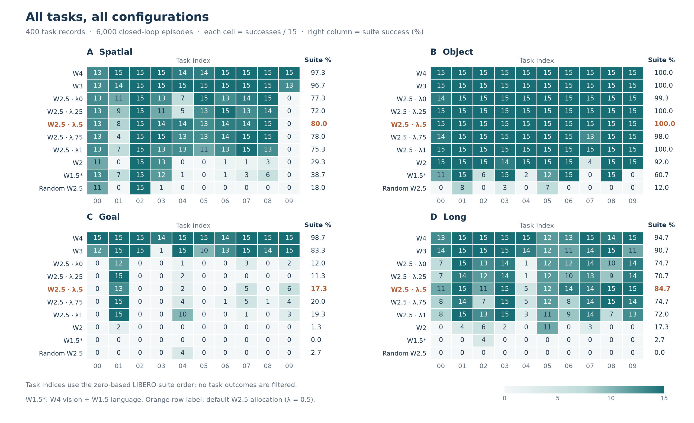

# Thirteen cases, from matrices to robot tasks

[Home](../README.md) · [Paper figures](PAPER_FIGURES.md) · [Principles](PRINCIPLES.md) · [Result data](../results/)

**10 configurations · 6,000 episodes · 40 tasks · 428 target matrices.** Explore the paper's original tables alongside detailed views of the released results. Each configuration has 150 episodes per suite and 15 per task. These are historical measurements; this repository update adds visual analysis, not new evaluations.

## 1. Task quality across five precision budgets

<p align="center">
  <a href="../assets/overview.png"></a>
</p>

| Case | Measured behavior | How to read it |
| --- | --- | --- |
| **01 · W3 retention** | **556/600 (92.7%)**, compared with 586/600 (97.7%) at W4 | The 5.0-point difference is descriptive, not a significance test. |
| **02 · Spatial at W2.5** | **120/150 (80.0%)** | The pooled 70.5% average conceals differences between suites. |
| **03 · Object at low precision** | **150/150** at W3 and W2.5; **138/150 (92.0%)** at W2 | Retention on Object does not imply equal retention elsewhere. |
| **04 · Goal failures** | W3 **125/150** → W2.5 **26/150** → W2 **2/150** → W1.5* **0/150** | Failure cases matter when selecting a deployment budget. |
| **05 · Long: guided vs random** | Guided W2.5 **127/150 (84.7%)**; calibrated random **0/150** | Both configurations include calibration; this does not isolate calibration itself. |
| **09 · Asymmetric W1.5\*** | **153/600 overall**; Spatial **58/150**, versus **44/150** at W2 | Vision stays W4, language averages W1.5; target-weight average is about 1.75 bits. |

### The complete paper comparison

<p align="center">
  <a href="../assets/paper/table1_task_success.png"></a>
</p>

Original table from manuscript page 4. The highlighted AGQ rows use EXP019; AWQ, GPTQ, QVLA and the 96.9% FP16 reference are literature results, recorded in [published_baselines.json](../results/published_baselines.json). Missing literature precisions are not filled with fabricated zeros. Click any figure for its full-resolution view.

## 2. What changes when the allocation changes?

<p align="center">
  <a href="../assets/lambda_sweep.png"></a>
</p>

| Case | Measured behavior | How to read it |
| --- | --- | --- |
| **06 · Five lambda settings** | λ = 0 / 0.25 / 0.5 / 0.75 / 1 gives **395 / 381 / 423 / 406 / 400** successes out of 600 | λ = 0.5 is 4.7 percentage points above λ = 0 after rounding. |
| **07 · Overall vs suite winner** | Goal: λ = 0.75 gives **30/150**, versus **26/150** at λ = 0.5; overall **406/600** versus **423/600** | The best overall setting need not win every suite. |
| **08 · Guided vs random allocation** | Calibrated random **49/600 (8.2%)**; guided W2.5 **423/600 (70.5%)** | Supports informed allocation within the calibrated pipeline, not a separate calibration ablation. |
| **13 · 428 matrix assignments** | W1/W2/W3/W4 counts change from **54/107/189/78** at λ = 0 to **19/150/199/60** at λ = 0.5 | These are matrix counts, not parameter-weighted average bitwidths. |

### Where the different priorities come from

<p align="center">
  <a href="../assets/paper/figure3_allocation_sensitivity.png"></a>
</p>

Paper Figure 3 combines the allocation table and three matrix-level views. The plotted action sensitivities span **20.2×**, while recovery overhead varies **2.0×**. These describe the displayed measurements, not a statistical significance test. The original figure's sensitivity and score axes are logarithmic; the overhead axis uses microseconds. See [the allocation principles](PRINCIPLES.md#3-allocate-integer-bitwidths-under-real-storage-budgets) and [allocation counts](../results/allocations.json).

## 3. Storage, memory and latency belong together

<p align="center">
  <a href="../assets/resource_tradeoff.png"></a>
</p>

| Case | Measured behavior | How to read it |
| --- | --- | --- |
| **10 · Whole-model compression** | W1.5*: **2.656 GB / 250.5 ms** uncoded → **2.534 GB / 310.4 ms** coded | **6.10×** complete-model compression; **3.537 GB** peak memory; coding adds **59.9 ms**. |
| **11 · Two coding implementations** | CODEBOOK001: **2.784 GB / 1771.9 ms**; CODEBOOK003: **3.537 GB / 310.4 ms** | The minimum-memory point and faster decoder are separate configurations. |
| **12 · Configuration-dependent overhead** | Coded W2.5 **473.9 ms**; coded W1.5* **310.4 ms** | Stored bitwidth alone does not determine full model-action latency. |

The [original performance table](../assets/paper/table2_storage_performance.png) and [machine-readable measurements](../results/performance.json) retain the model size, peak allocated memory and latency for each configuration. The resource measurements use RTX3090 and a fixed inference window after loading and warmup.

## 4. Inspect all 40 tasks, including failures

<p align="center">
  <a href="../assets/task_heatmap.png"></a>
</p>

All ten tasks in each of four suites are shown across **all ten configurations**, including the five lambda settings and calibrated random control: **400 aggregate cells**, each out of 15 episodes. [tasks.csv](../results/tasks.csv) contains the values. Task IDs follow zero-based LIBERO suite indices; no task is filtered by outcome.

## Recompute and trace

```bash
python scripts/verify_results.py
python assets/generate_figures.py
```

Plot regeneration requires Matplotlib and NumPy. The [case catalog](../examples/cases/catalog.json) records the original 13 cases, configurations and interpretations. The [paper-figure gallery](PAPER_FIGURES.md) maps all six original figures/tables to manuscript pages and extraction records. The [measurement guide](../results/README.md) defines each metric.

The original teaser retains a BF16 axis label at its 96.9% point, whose source is the FP16 literature reference. Optional coding measurements are separate from EXP019 quality; exact weight reconstruction does not establish identical closed-loop trajectories. These descriptive cases do not assert statistical significance.
